# Classificador de Mensagens de Clientes com IA

Desafio Técnico KODIE — IA e Automação · **Caso 4.1 — Classificação de Mensagens**

A mensagem do cliente chega no **n8n**, que a envia para uma **API em FastAPI**. A API usa o **Gemini** para classificá-la e devolver um **JSON validado**. Com esse JSON, o n8n **encaminha a mensagem para o canal do Discord do setor responsável**.

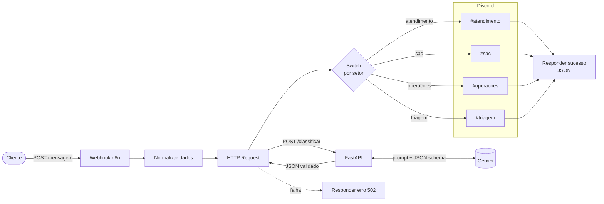

---

## 1. Apresentação da Ideia

A ideia surgiu do cenário que o desafio descreve e que é comum em pequenas empresas: uma pessoa precisa ler cada mensagem, entender o assunto e encaminhá-la manualmente para o setor certo. Nas aulas usamos o Gemini atrás de um microsserviço FastAPI e conectamos esse microsserviço ao n8n. Este projeto junta essas peças em um problema real de triagem de atendimento.

Duas decisões guiaram o projeto desde o começo:
- **A IA interpreta e o código decide.** Entender um texto livre ("veio quebrado, quero trocar!") é o ponto forte do modelo de linguagem, então é a IA que classifica. Já *para onde* a mensagem vai é uma regra fixa no código, previsível e fácil de auditar ou mudar sem mexer no prompt.
- **A automação faz o trabalho repetitivo e a pessoa continua no controle.** O n8n cuida do encaminhamento, que é o que hoje consome o tempo do atendente. A resposta ao cliente continua sendo uma *sugestão*, e os casos duvidosos são marcados para revisão humana.

## 2. Problema Escolhido

**4.1 — Classificação de Mensagens.** A loja recebe dúvidas, reclamações, pedidos e elogios por vários canais (site, e-mail, WhatsApp), sem nenhuma organização. Isso causa demora, mensagens esquecidas e reclamações graves tratadas com a mesma prioridade de uma dúvida simples.

## 3. Solução Proposta

Para cada mensagem, a IA identifica:

| Campo | Valores | Para que serve |
|---|---|---|
| `categoria` | `duvida`, `reclamacao`, `solicitacao`, `elogio`, `outro` | tipo da mensagem |
| `urgencia` | `baixa`, `media`, `alta` | prioridade (🚨 no Discord quando é alta) |
| `sentimento` | `positivo`, `neutro`, `negativo` | humor do cliente |
| `assunto` / `resumo` | texto curto | leitura rápida pelo atendente |
| `resposta_sugerida` | 1–2 frases | acelera a primeira resposta |
| `confianca` | 0 a 1 | grau de certeza da classificação |

A **IA só classifica**. Quem recebe a mensagem é decidido pelo **código**, com uma regra fixa e auditável:

| Categoria | Setor (canal no Discord) |
|---|---|
| duvida, elogio | `atendimento` |
| reclamacao | `sac` |
| solicitacao | `operacoes` |
| outro | `triagem` |

Quando a confiança fica abaixo de `0.6` ou a categoria é `outro`, a resposta traz `revisao_humana: true` e o Discord exibe um aviso ⚠️.

### Como garantimos que a resposta da IA está no formato certo
1. **Prompt estruturado** ([app/prompts.py](app/prompts.py)) com papel, critérios para cada categoria, regras de desempate, critérios de urgência, formato de saída e exemplos (few-shot). A mensagem do cliente vai entre marcadores `<<< >>>` e é tratada como dado, não como instrução, o que reduz o risco de *prompt injection*.
2. **Saída estruturada do Gemini**: `response_mime_type="application/json"` + `response_schema` com o modelo Pydantic `ClassificacaoIA`. Os enums restringem os valores possíveis.
3. **Validação com Pydantic** do JSON recebido. Se vier inválido, a API **tenta de novo uma vez**. Se falhar de novo, responde **HTTP 502** e o n8n segue pelo ramo de erro.
4. `temperature=0.1`, para manter as respostas consistentes.

## 4. Tecnologias Utilizadas

- **Python 3.12+**, **FastAPI**, **Uvicorn**, **Pydantic**
- **Google Gemini** (`google-genai`, modelo `gemini-3.5-flash-lite`)
- **n8n**: Webhook, Edit Fields (Set), HTTP Request, Switch, Discord e Respond to Webhook
- **Discord** (webhooks, um canal por setor)
- **pytest** (testes com o Gemini simulado)
- **Docker / Docker Compose** (opcional)

## 5. Funcionamento do Sistema

### API ([app/main.py](app/main.py))

| Método | Rota | Descrição |
|---|---|---|
| GET | `/health` | status e modelo em uso |
| GET | `/categorias` | mapa categoria → setor |
| POST | `/classificar` | classifica uma mensagem |
| GET | `/docs` | Swagger para testar a API |

**Requisição**
```json
{ "mensagem": "Fui cobrado duas vezes no cartão pela mesma compra! Se não estornarem até amanhã vou abrir reclamação no Procon.", "cliente": "Marcos", "canal": "email" }
```
**Resposta real do Gemini** (a mesma que aparece no print do HTTP Request, seção 7.3)
```json
{
  "categoria": "reclamacao",
  "assunto": "cobrança dupla no cartão",
  "urgencia": "alta",
  "sentimento": "negativo",
  "resumo": "Cliente relata cobrança dupla no cartão e ameaça acionar o Procon caso não haja estorno.",
  "resposta_sugerida": "Lamentamos o ocorrido com a cobrança em duplicidade e estamos verificando o seu caso com urgência. Entraremos em contato em breve para resolver a situação.",
  "confianca": 0.95,
  "setor": "sac",
  "revisao_humana": false,
  "mensagem_original": "Fui cobrado duas vezes no cartão pela mesma compra! Se não estornarem até amanhã vou abrir reclamação no Procon.",
  "cliente": "Marcos",
  "canal": "email",
  "modelo": "gemini-3.5-flash-lite"
}
```

### Fluxo n8n ([n8n/workflow-classificacao.json](n8n/workflow-classificacao.json))

| # | Node | Função |
|---|---|---|
| 1 | **Receber mensagem (Webhook)** | `POST /webhook/mensagens` recebe `{mensagem, cliente, canal}` |
| 2 | **Normalizar dados** (Edit Fields) | remove espaços, preenche padrões (`cliente`, `canal`) e registra `recebido_em` |
| 3 | **Classificar com IA (API)** (HTTP Request) | `POST http://127.0.0.1:8000/classificar`; em caso de erro, segue pela saída de erro |
| 4 | **Rotear por setor** (Switch) | 4 saídas: `atendimento`, `sac`, `operacoes`, `triagem` |
| 5 | **Discord - <setor>** | publica no canal do setor: categoria, urgência, resumo, mensagem e sugestão de resposta |
| 6 | **Responder sucesso** | devolve `{status: "encaminhado", setor, classificacao}` |
| 7 | **Responder erro** | devolve HTTP 502 se a API ou a IA falhar |

## 6. Como Executar

### Pré-requisitos
- Python 3.12+ e n8n (local via `npx n8n`/`npm i -g n8n` ou Docker)
- Chave do Gemini: https://aistudio.google.com/apikey
- Um servidor no Discord com 4 canais (`#atendimento`, `#sac`, `#operacoes`, `#triagem`) e um webhook em cada canal (*Editar canal → Integrações → Webhooks → Novo webhook → Copiar URL*)

### Passo a passo (local)
```powershell
cd desafio-classificacao-mensagens
python -m venv venv
.\venv\Scripts\activate
pip install -r requirements.txt
copy .env.example .env      # preencha as variáveis
uvicorn app.main:app --reload --port 8000
```
Teste a API em http://localhost:8000/docs ou rode:
```powershell
python scripts/enviar_exemplos.py --api
```

### Importar o fluxo no n8n
**Opção A, automática:** crie uma API key no n8n (*Settings → n8n API*), coloque em `N8N_API_KEY` no `.env` e rode:
```powershell
python scripts/configurar_n8n.py
```
O script cria as 4 credenciais do Discord, importa o workflow e o ativa.

**Opção B, manual:** no n8n, *Workflows → Import from File → `n8n/workflow-classificacao.json`*. Em cada node do Discord, crie uma credencial *Discord Webhook* com a URL do canal e depois ative o workflow.

### Enviar mensagens pelo fluxo
```powershell
python scripts/enviar_exemplos.py
```
ou
```powershell
curl -X POST http://localhost:5678/webhook/mensagens -H "Content-Type: application/json" -d "{\"mensagem\":\"Quero trocar o tamanho da camiseta\",\"cliente\":\"Ana\",\"canal\":\"whatsapp\"}"
```

### Testes
```powershell
pip install pytest httpx
pytest -q
```

### Docker (opcional): tudo com um comando
Só é preciso preencher no `.env` a `GEMINI_API_KEY` e os 4 `DISCORD_WEBHOOK_*`. A `N8N_API_KEY` não é necessária no Docker.
```powershell
copy .env.example .env
docker compose up -d --build
```
O compose sobe três serviços:

| Serviço | O que faz |
|---|---|
| `api` | constrói a imagem da API ([Dockerfile](Dockerfile)) e só é considerada pronta quando `/health` responde |
| `n8n-init` | roda uma vez e termina: [n8n/docker-init.js](n8n/docker-init.js) cria as credenciais do Discord a partir do `.env`, aponta o HTTP Request para `http://api:8000` e importa e publica o workflow pela CLI do n8n |
| `n8n` | sobe já com o fluxo ativo, depois que o `n8n-init` terminou e a API está saudável |

Depois disso, sem configurar nada na interface:
```powershell
python scripts/enviar_exemplos.py      # envia para http://localhost:5678/webhook/mensagens
```
- API: http://localhost:8000/docs · n8n: http://localhost:5678 (no primeiro acesso, crie o usuário dono para ver o fluxo)
- Se as portas 8000 ou 5678 já estiverem em uso, troque com variáveis: `$env:API_PORT='8001'; $env:N8N_PORT='5679'; docker compose up -d`
- Para parar: `docker compose down` (os dados do n8n ficam no volume `n8n_data`)

> Testado com Docker 28.3.2 e n8n 2.35.7. A mensagem *"quero cancelar minha assinatura"* enviada ao n8n do container foi classificada como `solicitacao`, encaminhada ao `#operacoes` e respondida com status `encaminhado`. Rodar `docker compose up` de novo reimporta o fluxo sem duplicar nada.

---

## 7. Documentação do Fluxo (prints)

> Os prints ficam em [`docs/prints/`](docs/prints/). Os prints dos nodes são da execução real da mensagem *"Fui cobrado duas vezes no cartão... vou abrir reclamação no Procon"*. Cada um mostra a configuração no centro, a entrada à esquerda e a saída à direita.

### 7.1 Fluxo completo
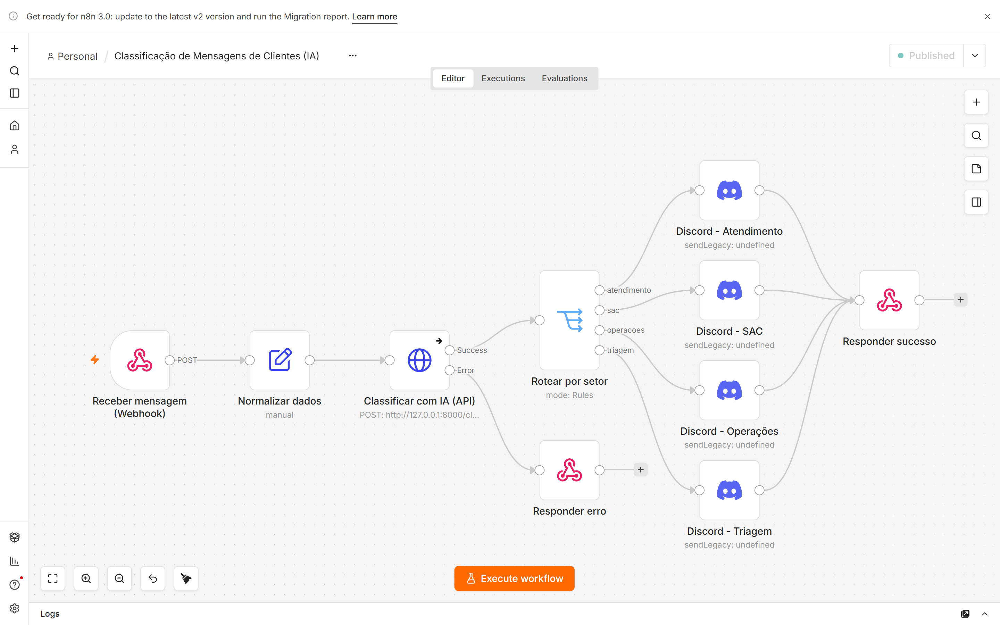
*Todos os nodes conectados: o webhook recebe a mensagem, que é normalizada, classificada pela API/IA, roteada por setor e enviada ao Discord, e o fluxo responde a quem chamou. Se a API falhar, a saída de erro do HTTP Request leva ao "Responder erro".*

### 7.2 Execução bem-sucedida
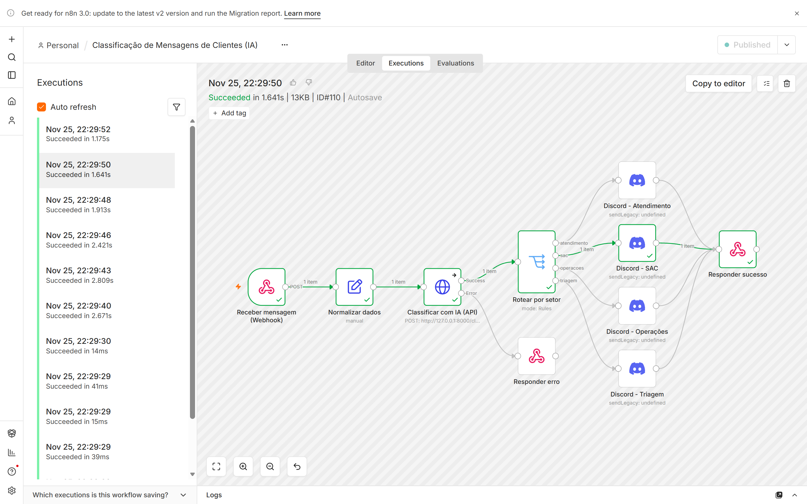
*Execução #110 concluída em 1,6 s: a reclamação seguiu pelo ramo `sac`, foi publicada no canal #sac e o webhook devolveu o JSON da classificação.*

### 7.3 Configuração dos nodes e dados em cada etapa

**1. Receber mensagem (Webhook):** `POST /webhook/mensagens`, que responde pelo node *Respond to Webhook*.
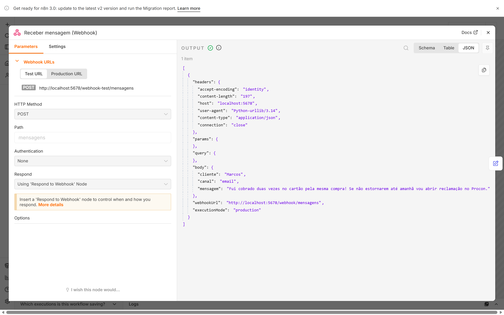

**2. Normalizar dados (Edit Fields):** extrai `mensagem`, `cliente` e `canal` do `body`, aplica valores padrão e registra `recebido_em`.
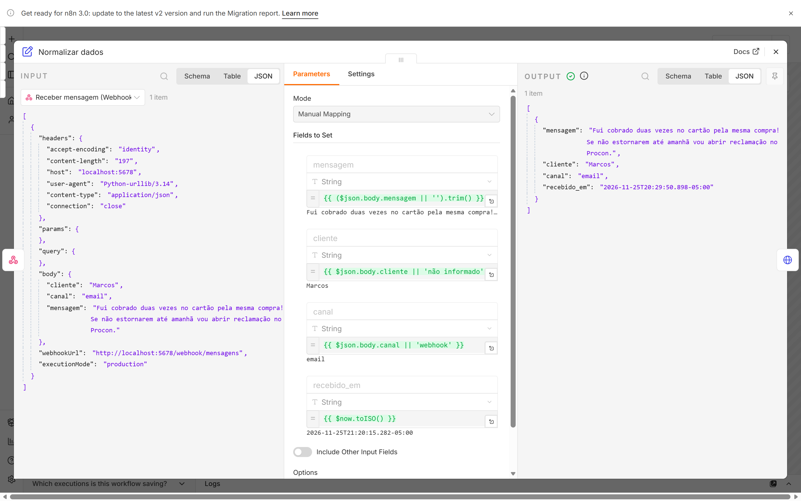

**3. Classificar com IA (HTTP Request):** `POST http://127.0.0.1:8000/classificar` com corpo JSON. A saída é o JSON validado que a IA gerou: categoria `reclamacao`, urgência `alta`, setor `sac` e confiança 0.95.
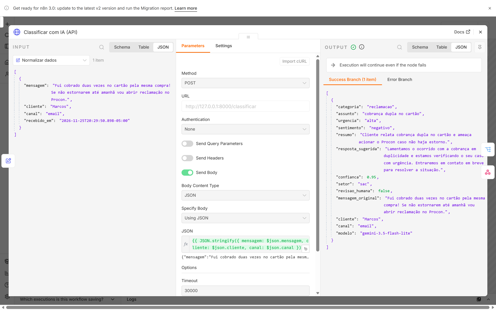

**4. Rotear por setor (Switch):** 4 regras `{{ $json.setor }} is equal to ...`, uma saída por setor. Aqui o item saiu na saída **Sac**.
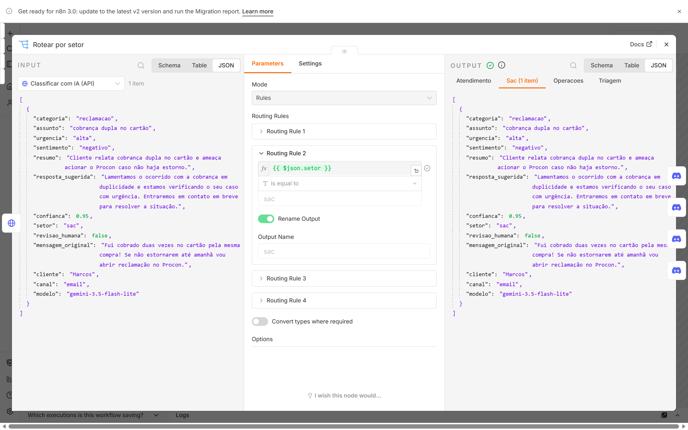

**5. Discord - SAC:** conexão por webhook (a credencial fica só no n8n). A mensagem é montada com expressões: 🚨 para urgência alta, categoria, resumo, mensagem original e sugestão de resposta. O Discord retornou `success: true`.
Os outros três nodes do Discord (Atendimento, Operações e Triagem) têm a mesma configuração e mudam só a credencial, ou seja, o canal de destino.
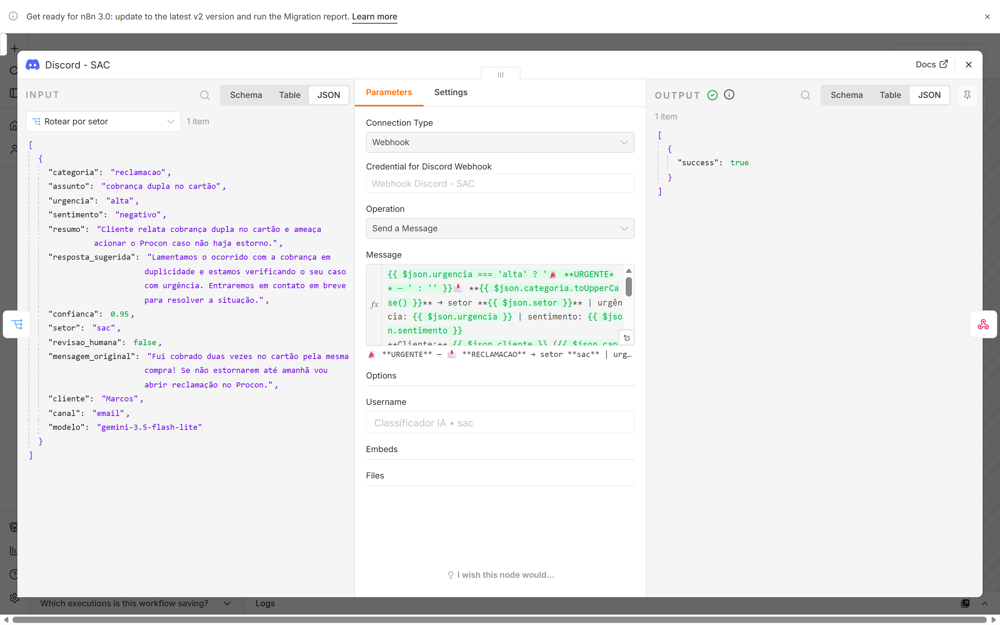

**6. Responder sucesso (Respond to Webhook):** devolve `{ status: "encaminhado", setor, classificacao }` para quem enviou a mensagem.
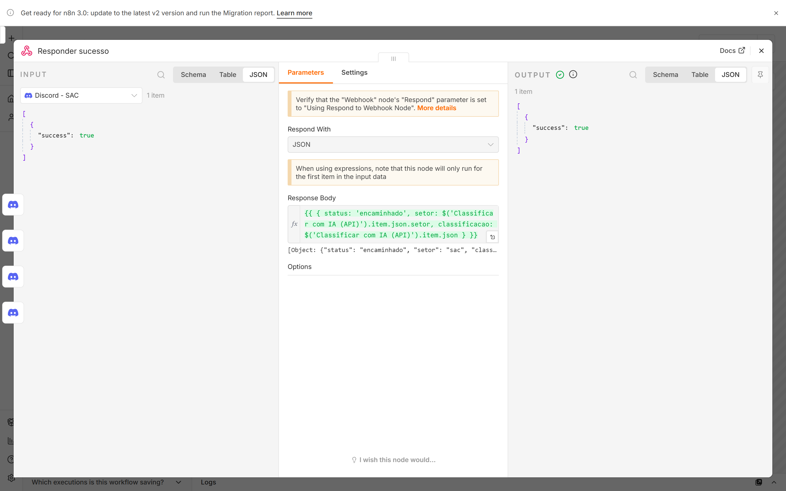

**7. Responder erro (Respond to Webhook):** recebe a saída de erro do HTTP Request e devolve **HTTP 502** com `{ status: "erro", detalhe }`. No print, a API estava desligada (`ECONNREFUSED`).
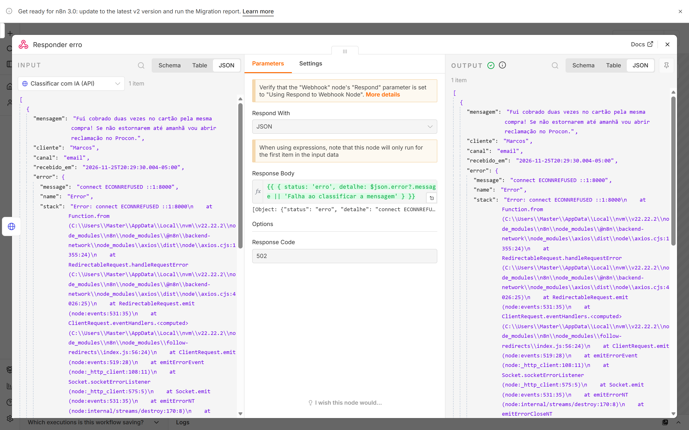

### 7.4 Resultados

**Tratamento de erro:** execução feita com a API fora do ar. O HTTP Request falhou e o fluxo seguiu pela saída de erro até o *Responder erro* (HTTP 502), sem travar.
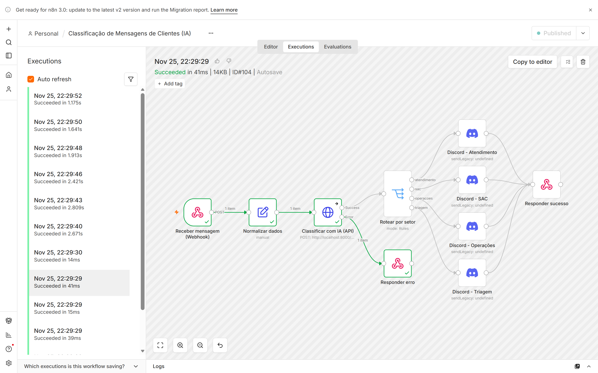

**Mensagens no Discord:** cada setor recebe as mensagens no seu próprio canal, já com resumo e sugestão de resposta.

`#atendimento`: dúvida e elogio
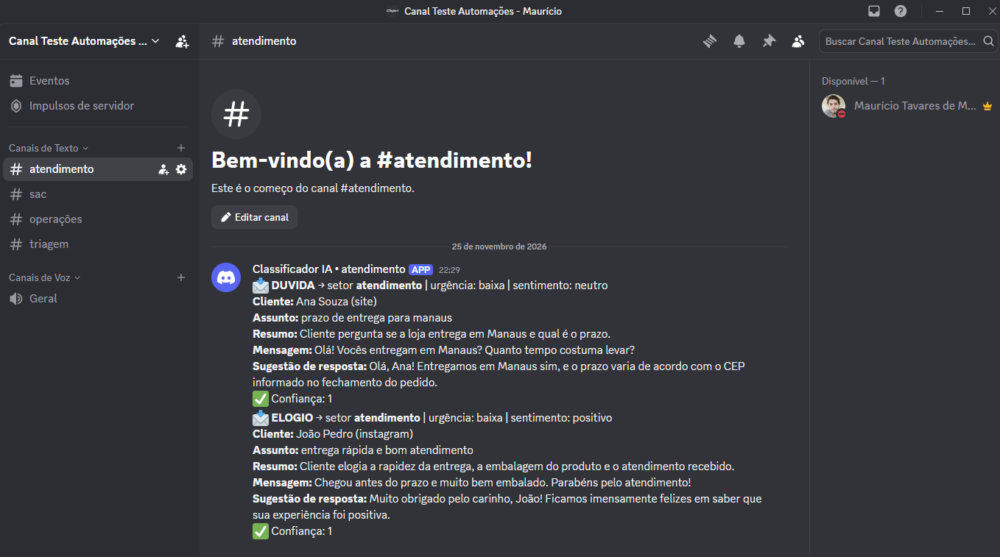

`#sac`: reclamações com urgência alta (🚨)
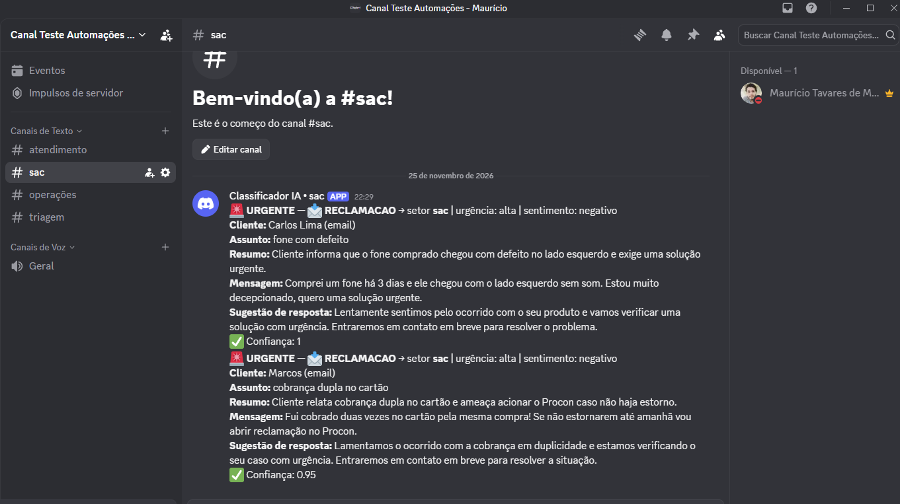

`#operacoes`: pedido de 2ª via de boleto
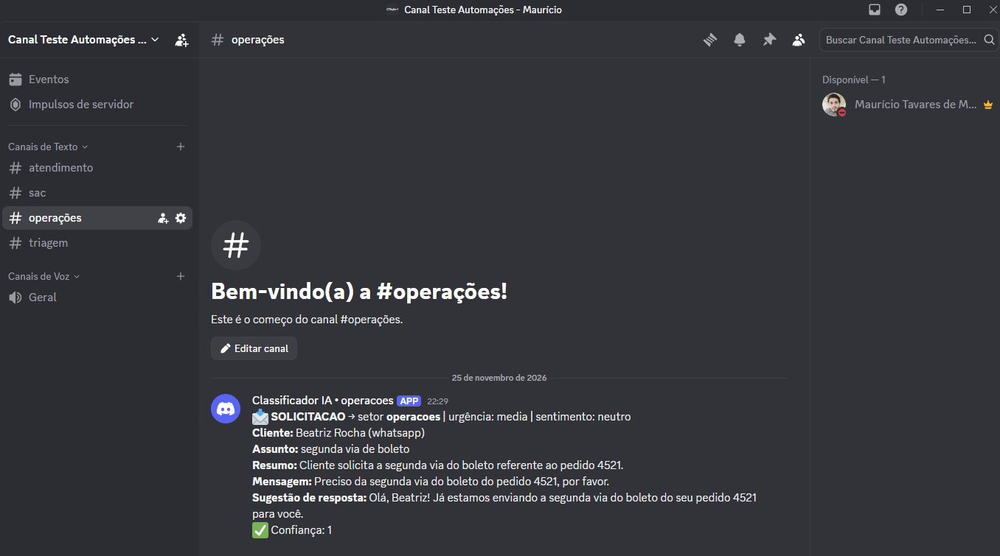

`#triagem`: spam marcado para revisão humana (⚠️)
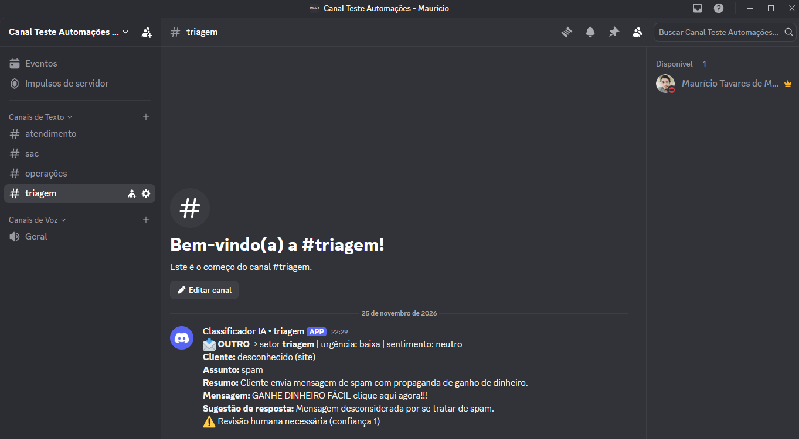

**Resultado das 6 mensagens de exemplo** (`python scripts/enviar_exemplos.py`, via n8n):

| Mensagem | Categoria | Setor | Urgência | Revisão humana |
|---|---|---|---|---|
| "Vocês entregam em Manaus?" | duvida | atendimento | baixa | não |
| "Fone chegou sem som... quero solução urgente" | reclamacao | sac | alta | não |
| "Segunda via do boleto do pedido 4521" | solicitacao | operacoes | media | não |
| "Chegou antes do prazo... parabéns" | elogio | atendimento | baixa | não |
| "Cobrado duas vezes... Procon" | reclamacao | sac | alta | não |
| "GANHE DINHEIRO FÁCIL clique aqui" | outro | triagem | baixa | **sim** |

---

## 8. Observações e limitações

Pontos que notamos ao analisar os resultados reais e o que eles mostram sobre o desenho da solução.

**A IA pode errar no texto, por isso a resposta é só uma sugestão.** No canal `#sac` (print 11), a sugestão de resposta começa com *"**Lentamente** sentimos pelo ocorrido..."*, quando o certo seria "Lamentamos". A classificação estava correta, mas o texto gerado tinha um erro de palavra. Por isso o sistema **não responde ao cliente automaticamente**: o campo se chama `resposta_sugerida` e vai para o atendente revisar antes de enviar. Classificar e rotear são tarefas de baixo risco que podem ser automatizadas; falar com o cliente em nome da empresa continua com uma pessoa.

**A "confiança" é a autoavaliação do modelo, e não é a única regra de revisão.** No `#triagem` (print 13), o spam aparece com *"Revisão humana necessária (confiança 1)"*. Parece contraditório, mas não é: a IA estava certa de que a mensagem não pertence a nenhuma categoria, e **toda mensagem `outro` vai para revisão humana por regra**, independentemente da confiança. A revisão também é acionada quando a confiança fica abaixo de `0.6`. Duas ressalvas:
- O número de confiança é estimado pelo próprio modelo e não é uma probabilidade calibrada. Nas 6 mensagens de teste, ele ficou entre 0.95 e 1. Por isso ele é só um dos critérios de revisão.
- Uma melhoria simples seria mostrar no Discord o **motivo** da revisão ("fora das categorias" ou "confiança baixa").

**Outras limitações conhecidas**
- Cada mensagem recebe **uma só categoria**. Uma mensagem com dois assuntos ("quero trocar o produto e também saber o prazo do outro pedido") segue pela regra de desempate do prompt, e o segundo assunto fica só no resumo.
- O roteamento depende de uma chamada à API do Gemini. Se a API estiver fora do ar ou o limite de uso estourar, o fluxo responde 502 (print 09). Quem enviou a mensagem é avisado do erro e pode reenviar, e o conteúdo fica registrado no histórico de execuções do n8n. Uma evolução seria uma fila de reprocessamento automático.
- Detalhe técnico encontrado durante a integração: no Windows, o n8n (Node.js) resolve `localhost` como IPv6 (`::1`), enquanto o Uvicorn escuta em `127.0.0.1`. Por isso o HTTP Request usa `http://127.0.0.1:8000`.

---

## Estrutura do projeto
```
app/
  main.py            # rotas FastAPI
  classificador.py   # chamada ao Gemini, validação e roteamento
  prompts.py         # prompt estruturado
  schemas.py         # modelos Pydantic (entrada, saída da IA, resposta)
n8n/workflow-classificacao.json   # fluxo exportado do n8n
n8n/docker-init.js                # prepara credenciais + workflow no docker compose
scripts/configurar_n8n.py         # importa o fluxo e cria as credenciais via API do n8n
scripts/enviar_exemplos.py        # envia mensagens de exemplo
exemplos/mensagens.json
tests/test_api.py
Dockerfile · .dockerignore · docker-compose.yml · .env.example
```

> 🔒 Nenhuma chave fica no repositório: tudo está no `.env` (ignorado pelo git). As credenciais do Discord ficam só no n8n.
